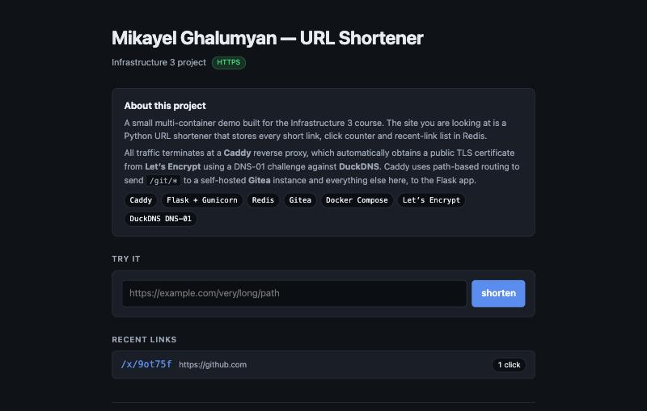
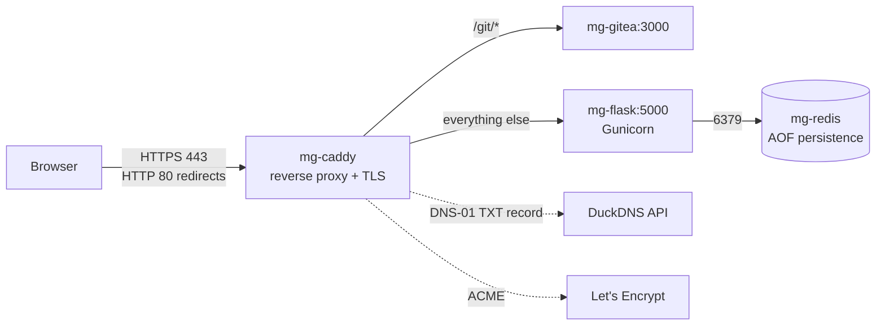

# URL shortener behind Caddy with automatic HTTPS

A small multi-container setup: a Flask URL shortener backed by Redis, and a self-hosted Gitea, both behind a Caddy reverse proxy. Caddy gets a real TLS certificate from Let's Encrypt through a DNS-01 challenge. Everything runs with `docker compose up`.



Solo project for the Infrastructure 3 course. The original setup used the domain `infra-mikayel-ghalumyan.duckdns.org`, which pointed to 127.0.0.1 so the lecturer could test it locally.


## What I built

The site is a URL shortener I wrote in Python (Flask). You paste a long
URL, you get a short link like `/x/abc123`, and clicking it redirects
you and increments a click counter. All the data is stored in Redis.

Behind the same domain, the `/git/` path goes to Gitea (the
ready-made app I had to reuse). So both apps live behind one proxy
with path-based routing.


## Stack

| Component      | What I used                  | Class default | Deviated? |
|----------------|------------------------------|---------------|-----------|
| Reverse proxy  | Caddy (built with xcaddy)    | Nginx         | yes       |
| DNS provider   | DuckDNS                      | DuckDNS       | no        |
| Certificate CA | Let's Encrypt                | Let's Encrypt | no        |
| Cert client    | Caddy built-in ACME          | Certbot       | yes       |
| 3rd party app  | Gitea (reused image)         | -             | -         |
| My own app     | Flask URL shortener          | -             | -         |
| Database       | Redis (NoSQL = bonus point)  | -             | -         |

So I deviated in 2 things (proxy and cert client), which is the minimum
the assignment asked for.

All container, network and volume names start with `mg-` (Mikayel
Ghalumyan).


## Architecture



There are 4 containers, all on the same `mg-net` bridge network. Only
`mg-caddy` opens ports to the host (80 and 443). The other three are
only reachable inside the network.

How Caddy decides where to send a request:

- `/git/...` -> `mg-gitea:3000`  (Caddy uses `handle_path /git/*` so
  the `/git/` prefix is stripped before forwarding)
- everything else -> `mg-flask:5000`
- plain HTTP on port 80 -> automatic 301 redirect to HTTPS

Only `mg-flask` talks to `mg-redis` (on TCP 6379, inside the network).


## Why I made these choices

**Caddy instead of Nginx.** Caddy can get a certificate automatically
on the first start, you don't need a separate Certbot, no cron job, no
reload hook. The config is also much shorter than the Nginx equivalent.
The downside is you have to build your own Caddy if you want a non
default DNS provider plugin, which is why my `caddy/Dockerfile` uses
`xcaddy`.

**DNS-01 challenge instead of HTTP-01.** Because the assignment says
DNS must point to 127.0.0.1 for the lecturer to test locally, an
HTTP-01 challenge would fail (Let's Encrypt cannot reach a 127.0.0.1
address from the internet). DNS-01 works by creating a TXT record at
DuckDNS, which is fine because the DuckDNS DNS service is publicly
reachable.

**Redis as database.** A URL shortener is basically key -> value, which
is exactly what Redis is good at. It also covers the NoSQL bonus point.
The app uses 3 different Redis operations:
- `SET mg:url:<code> <url>` to save a shortened link
- `INCR mg:clicks:<code>` to count clicks atomically
- `LPUSH/LTRIM/LRANGE mg:recent` for the "recent links" list

I turned on AOF (`--appendonly yes`) so data is not lost on restart.

**Gitea as the 3rd party app.** It is a real self-hosted Git web UI
(small version of GitHub). I picked it because it is one container,
recognizable, and proves the proxy works in front of a non trivial app
and not just a hello world. I did not touch the Gitea code or image,
only added some env vars so Gitea generates links pointing to `/git/`.

**Multi-stage Dockerfile for the Flask app.** First stage installs the
Python packages into a virtualenv, second stage copies only the
virtualenv + the source. The build tools and pip cache stay in stage 1
so the final image is smaller.


## Folder layout

```
.
├── docker-compose.yml      everything: services, network, volumes
├── .env.example            template version
├── .gitignore
├── caddy/
│   ├── Dockerfile          builds Caddy with the DuckDNS plugin
│   └── Caddyfile           proxy + TLS config
├── app/
│   ├── Dockerfile          multi-stage Flask image
│   ├── requirements.txt
│   ├── requirements-dev.txt  test dependencies
│   ├── app.py              the URL shortener code
│   ├── templates/
│   │   └── index.html      the homepage
│   └── tests/              pytest tests (fakeredis)
├── docker-compose.local.yml  local mode without Caddy
├── docs/
│   └── screenshot.jpg
└── README.md
```


## How to run it

You need Docker (Docker Desktop on Mac/Windows or Docker Engine on
Linux) with Compose v2.

```bash
# get the code
git clone https://github.com/miqqayell/url-shortener-docker-caddy.git
cd url-shortener-docker-caddy

cp .env.example .env
# then edit .env and put your own DOMAIN, ACME_EMAIL, DUCKDNS_TOKEN

# start everything
docker compose up --build -d

# watch Caddy until the cert is ready
docker compose logs mg-caddy -f
# look for: "certificate obtained successfully"
```

The first run takes a couple of minutes because xcaddy has to compile
Caddy with the DuckDNS plugin, then Caddy has to register a new
Let's Encrypt account and do the DNS-01 challenge (about 30-60 seconds
of waiting for DuckDNS propagation).

Then you can open in a browser:
- `https://<your-domain>/`  -> the URL shortener
- `https://<your-domain>/git/`  -> Gitea

**Local mode (no domain needed).** To try only the shortener and Redis on
http://localhost:8080:

```bash
docker compose -f docker-compose.yml -f docker-compose.local.yml up --build mg-flask mg-redis
```

**Tests.** The Flask app has pytest tests that use fakeredis, so no Redis is needed:

```bash
cd app
pip install -r requirements.txt -r requirements-dev.txt
python -m pytest
```

To stop:
```bash
docker compose down       # keep the cert + data volumes
docker compose down -v    # also delete volumes (clean reset)
```


## How TLS works step by step

1. `docker compose up` starts `mg-caddy`.
2. Caddy reads the Caddyfile and sees the `tls { dns duckdns ... }`
   block.
3. Caddy registers a new ACME account at Let's Encrypt.
4. Caddy asks Let's Encrypt for a certificate for
   `infra-mikayel-ghalumyan.duckdns.org`.
5. Let's Encrypt sends back a challenge token.
6. Caddy uses my DuckDNS token (from `.env`) to call the DuckDNS API
   and create a TXT record at
   `_acme-challenge.infra-mikayel-ghalumyan.duckdns.org`.
7. Let's Encrypt resolves this TXT record over the public internet
   (DuckDNS DNS servers are public, only the A record of the domain
   resolves to 127.0.0.1).
8. Validation passes, Caddy downloads the cert and starts serving HTTPS.
9. The cert is stored in the `mg-caddy-data` volume, so on the next
   start it is reused. Caddy renews it automatically before it expires
   (90 days).


## How the Flask app uses Redis

| Endpoint    | Method | What it does in Redis                                                |
|-------------|--------|----------------------------------------------------------------------|
| `/`         | GET    | `LRANGE mg:recent 0 9` + `GET mg:url:<code>` for each code           |
| `/shorten`  | POST   | `SET mg:url:<code> <url>`, `SET mg:clicks:<code> 0`, `LPUSH/LTRIM`   |
| `/x/<code>` | GET    | `GET mg:url:<code>` + `INCR mg:clicks:<code>` then 302 redirect      |
| `/health`   | GET    | `PING` (returns 200 if Redis is reachable)                           |

So the app really uses the database, not just runs it next to itself
(which the assignment explicitly says is not enough).


## How I tested it

**In the browser:**
- Opened https://infra-mikayel-ghalumyan.duckdns.org/, padlock is
  closed/green, no certificate warning.
- Submitted a long URL through the form. The page reloads with a new
  short link in the "recent links" list.
- Clicked the short link, got redirected to the original URL, came back
  and the click count went from 0 to 1.
- Opened /git/, Gitea install page appears.
- Called /health with curl, got `{"status":"ok"}`.

**Inside Redis:**
- `docker compose exec mg-redis redis-cli` then `KEYS mg:*` showed all
  the keys created by the Flask app.
- Restarted `mg-redis`, the data was still there thanks to AOF + the
  `mg-redis-data` volume.

**Clean run (simulating the lecturer):**
```bash
docker compose down -v
docker system prune -a -f
docker volume prune -a -f
docker network prune -f
# then unzip the submission to a new folder and:
docker compose up --build -d
```
On the fresh run Caddy gets a brand new cert and the site works again.


## Stuff I did NOT do (out of scope)

- TLS between Caddy and the backend containers. Inside the Docker
  network it is plain HTTP, only the perimeter (Caddy) is TLS. The
  assignment lists this as a bonus, not a requirement.
- Deploying to Google Cloud. The design supports it (you would just
  point DuckDNS at the VM public IP instead of 127.0.0.1, nothing in
  the compose file changes), but I didn't actually do it because for
  the submission the DNS must point to 127.0.0.1.


## What I learned

- **Docker and Compose:** multi-stage images, private bridge networks, named volumes and keeping only the proxy exposed.
- **Reverse proxies and TLS:** path-based routing with Caddy, and how ACME DNS-01 challenges issue real certificates even for a domain that points to 127.0.0.1.
- **Python and NoSQL:** a small Flask app on Redis, using atomic counters and capped lists, with AOF persistence.
- **Testing:** unit-testing a Redis-backed app with fakeredis.


## Context

University project, KdG Applied Computer Science, Infrastructure 3, 2025-2026. Solo project.

When preparing this repository I added the pytest tests, the local mode and this README update. The commit history shows each change.
